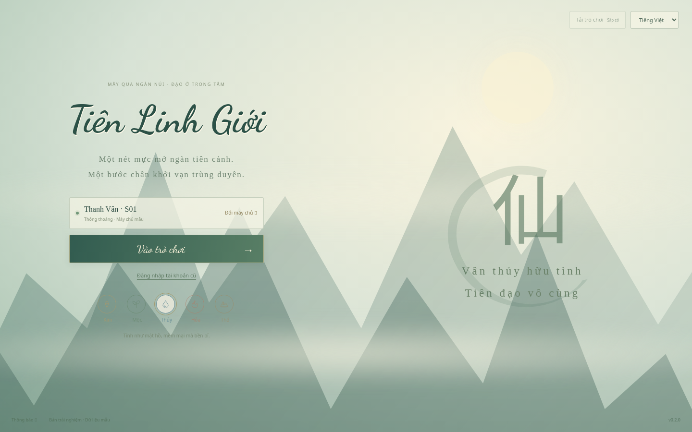
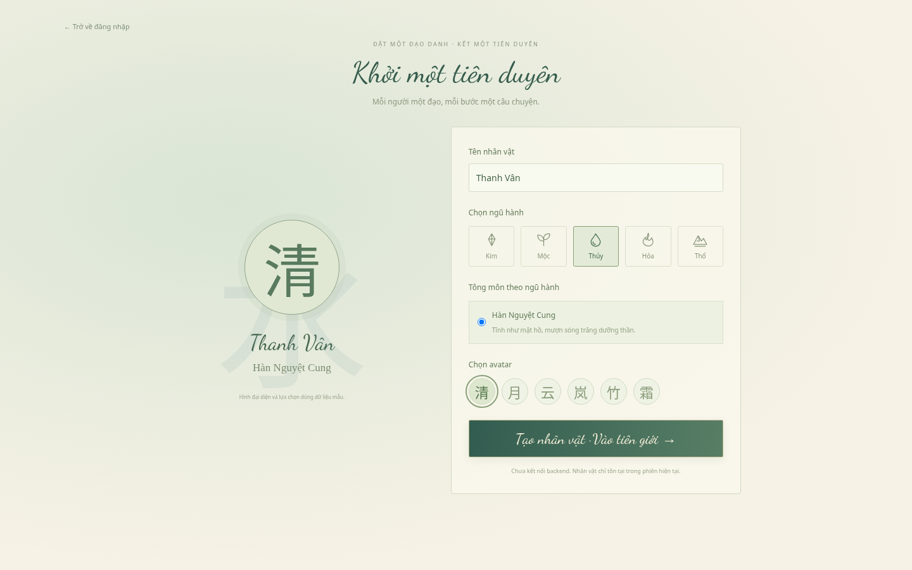
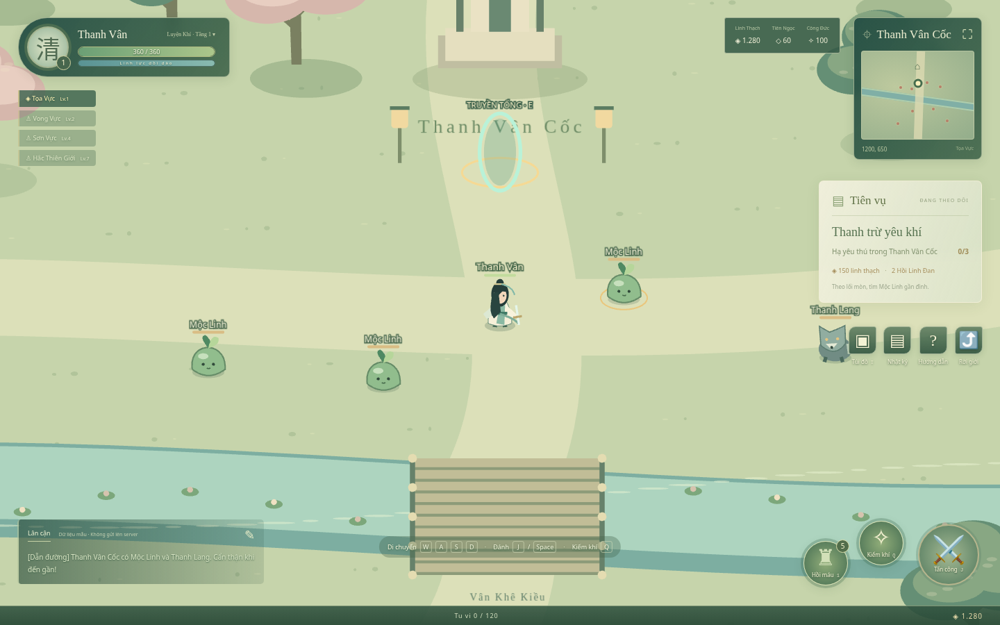
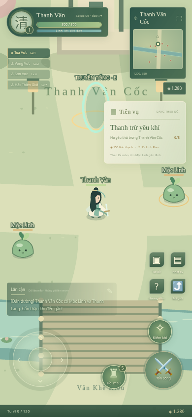
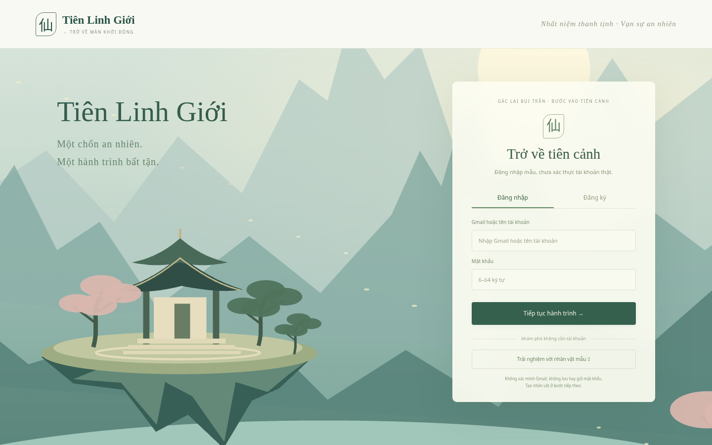

# Tiên Linh Giới

**Một chốn an nhiên. Một hành trình tu tiên.**

Tiên Linh Giới là dự án game nhập vai tu tiên 2D trên trình duyệt, lấy cảm hứng từ phong cách anime tiên cảnh thanh nhã với sắc xanh ngọc và trắng ngà. Người chơi điều khiển nhân vật trong thế giới nhìn từ trên xuống, khám phá bản đồ, chiến đấu với yêu thú và tích lũy tu vi trên hành trình tiên đạo.

Dự án gồm frontend có thể chơi thử và backend realtime được phát triển riêng. **Frontend hiện dùng dữ liệu mẫu, chưa kết nối backend**; đăng nhập, đăng ký và chat trên giao diện là mô phỏng, tiến trình đặt lại khi tải trang hoặc đăng xuất.

## Hình ảnh game

### Khởi động và tạo nhân vật — thủy mặc tiên cảnh






Ảnh chụp trực tiếp từ bản chơi mẫu hiện tại.

### Khám phá Thanh Vân Cốc trên PC



Điều khiển nhân vật bằng WASD, tiếp cận yêu thú và thi triển kỹ năng. Camera đi theo nhân vật; HUD hiển thị sinh lực, tiên vụ và tu vi.

### Chơi trên mobile



Bố cục dọc với joystick cảm ứng, nút đánh thường, Kiếm Khí và hồi máu.

### Bước vào tiên giới



## Trải nghiệm hiện có

### Frontend

- Màn khởi động toàn màn hình, máy chủ mẫu, ngũ hành, đăng nhập/đăng ký và tạo nhân vật với tông môn, avatar.
- Tọa Vực — bản đồ Thanh Vân Cốc góc nhìn thứ ba 2D từ trên xuống, camera theo nhân vật.
- Di chuyển tám hướng với tư thế chạy/ra đòn, camera theo nhân vật và va chạm địa hình.
- Cày quái lên cấp, qua cổng sang Trúc Ảnh Lâm (cấp 2) và Huyền Nguyệt Sơn (cấp 4).
- Hiệu ứng vệt chém, kiếm khí bay, vòng phép và hạt sáng trúng đòn.
- Chiến đấu với Mộc Linh và Thanh Lang: đánh thường, Kiếm Khí, hồi chiêu, sinh lực và hồi sinh.
- Nhận tu vi, linh thạch, linh thảo khi hạ quái; có tiên vụ mẫu, túi đồ, nhật ký và minimap.
- Bố cục riêng cho PC và mobile, joystick cảm ứng hỗ trợ cả màn hình dọc và ngang.

### Backend

- Đăng ký/đăng nhập bằng JWT; quản lý nhân vật, cảnh giới, tiền tệ và lưu vị trí vào MySQL.
- Bản đồ realtime qua Socket.io, lọc thực thể theo vùng nhìn và kiểm tra tốc độ di chuyển.
- Quái, chiến đấu, vật phẩm rơi, túi đồ, học kỹ năng và đột phá cảnh giới.
- Trang bị, cửa hàng NPC, bang hội, bạn bè, chặn người chơi, chat riêng và giao dịch.
- Workflow GitHub Actions dựng MySQL và chạy bộ kiểm thử backend khi có thay đổi liên quan.

Các tính năng backend trên chưa được tích hợp vào bản chơi frontend. Thông số và nội dung game vẫn đang dùng dữ liệu mẫu trong giai đoạn phát triển.

## Công nghệ

| Thành phần          | Công nghệ                                               |
| ------------------- | ------------------------------------------------------- |
| Giao diện           | Vue 3, TypeScript, Vite, TailwindCSS v4                 |
| Đồ họa game         | PixiJS v8, WebGL; nhân vật và cảnh vật vẽ bằng Graphics |
| Server              | Node.js, Express, TypeScript                            |
| Realtime            | Socket.io, MessagePack                                  |
| Dữ liệu và xác thực | MySQL, Prisma, JWT, bcrypt                              |
| Kiểm thử frontend   | Node test runner, Playwright                            |
| CI backend          | GitHub Actions, MySQL 8                                 |

## Chạy bản chơi mẫu

Cài Node.js **22.12+ hoặc 24 LTS**, npm và dùng trình duyệt hỗ trợ WebGL.

```bash
git clone https://github.com/tienlinhgioi/tien-linh-gioi.git
cd tien-linh-gioi/frontend
npm ci
npm run dev
```

Vite mặc định chạy ở cổng **5173**. Bấm **Vào trò chơi**, chọn đăng nhập mẫu hoặc trải nghiệm, rồi tạo nhân vật để vào Thanh Vân Cốc. Không cần khởi động backend, cài MySQL hay cung cấp tài khoản thật cho bản mẫu.

| Thao tác    | PC                  | Mobile            |
| ----------- | ------------------- | ----------------- |
| Di chuyển   | WASD / phím mũi tên | Joystick bên trái |
| Đánh thường | J / Space           | Nút tấn công      |
| Kiếm Khí    | Q                   | Nút Kiếm Khí      |
| Hồi máu     | 1                   | Nút đan dược      |
| Túi đồ      | I                   | Nút Túi đồ        |
| Hướng dẫn   | H                   | Nút dấu hỏi       |

## Build và kiểm thử frontend

Chạy trong thư mục `frontend/`:

```bash
npm run build       # kiểm tra TypeScript và tạo bản production trong dist/
npm test            # kiểm thử logic
npx playwright install chromium
npm run test:e2e     # kiểm thử trên PC, mobile dọc và mobile ngang
```

Playwright tự khởi động production preview; cần chạy build trước. Có thể xem bản production bằng `npm run preview` ở cổng **4173**.

## Chạy backend riêng

Cần MySQL và cấu hình kết nối, khóa JWT trong file `.env` cục bộ. Không đưa file này lên GitHub.

```bash
cd backend
cp .env.example .env
# Điền DATABASE_URL và JWT_SECRET của môi trường cục bộ trước khi tiếp tục.
npm ci
npx prisma migrate dev
npm run seed
npm run dev
```

Backend mặc định dùng cổng **3000**. Khởi động backend không tự kết nối bản frontend mẫu; phần tích hợp API và Socket.io là bước phát triển tiếp theo. Xem [tài liệu backend](backend/README.md) để biết cấu hình, hợp đồng API và các lệnh kiểm thử cần server đang chạy.

## Cấu trúc và tài liệu

```text
frontend/             Giao diện và bản chơi PixiJS
  src/components/     Đăng nhập, bản đồ game, tiên cảnh và hộp thoại
  src/data/           Dữ liệu mẫu và logic di chuyển/va chạm
  tests/              Kiểm thử logic
  e2e/                Kiểm thử trình duyệt
backend/              HTTP API, Socket.io và logic game server
  prisma/             Schema, migration và dữ liệu khởi tạo
  src/                Mã nguồn backend
  test/               Kiểm thử tích hợp
.github/workflows/    GitHub Actions
```

- [Frontend: cách chạy, điều khiển và phạm vi bản mẫu](frontend/README.md)
- [Backend: cấu hình, API và sự kiện realtime](backend/README.md)
- [Môi trường cloud: cài đặt và khởi động frontend](frontend/SETUP.md)
